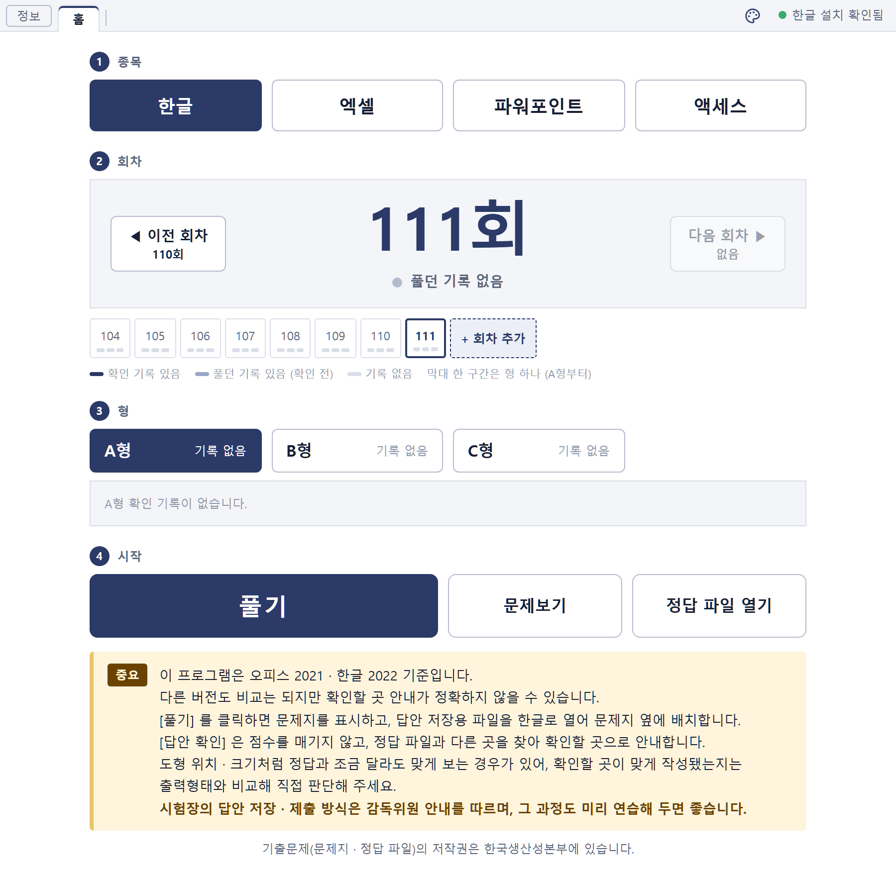

# 고잉 기출풀기 ITQ

ITQ 실기 기출문제와 응시 종목 프로그램을 실행해 바로 연습할 수 있게 하는 프로그램입니다.

답안 저장용 빈 파일을 만들어 한글 · 엑셀 · 파워포인트 · 액세스로 열어 문제지 옆에 배치하고, 저장한 답안 파일을 정답 파일과 비교해 확인할 곳을 알려 줍니다.

## 하는 일

- 종목 · 회차 · 형을 선택하고 [풀기] 를 클릭하면 답안 저장용 빈 파일을 만들어 한글 · 엑셀 · 파워포인트 · 액세스로 열고, 문제지와 나란히 배치합니다.
- 화면 아래쪽에 시험 시간(60분) 남은 시간이 표시됩니다.
- 답안을 저장하고 [답안 확인] 을 클릭하면 정답과 다른 곳(확인할 곳)이 영역별로 표시됩니다.
- 점수는 산정하지 않습니다.
- [문제보기] · [정답 파일 열기] 로 문제지와 정답 파일을 바로 확인합니다.
- 회차 자료는 회차를 처음 열 때 다운로드합니다.
- 목록에 없는 회차는 주관처 공식 사이트 기출문제 게시판에서 다운로드한 압축 파일을 [회차 추가] 에 끌어다 놓아 추가합니다.

## 필요한 것

- 윈도우 10 (32비트 · 64비트) · 윈도우 11
- 오피스 2021 · 한글 2022 기준입니다.
- 다른 버전도 비교는 되지만 확인할 곳 안내가 정확하지 않을 수 있습니다.

## 설치

1. [최신 설치 파일 다운로드](https://github.com/program-going/gichulpulgi-itq/releases/latest) 에서 `.exe` 파일을 다운로드합니다.
2. 다운로드한 파일을 실행하고 설치 화면의 안내대로 진행합니다.
   - 처음 실행할 때 '윈도우의 PC 보호' 창이 나오면 [추가 정보] → [실행] 을 클릭합니다.
3. 바탕 화면의 [고잉 기출풀기 ITQ] 를 실행합니다.

지난 버전은 [Releases](https://github.com/program-going/gichulpulgi-itq/releases) 에 있습니다.

## 업데이트

새 버전이 있으면 프로그램을 실행할 때 안내 창이 표시됩니다.

[업데이트] 를 클릭하면 새 버전을 설치하고 프로그램이 다시 실행됩니다.

안내 창을 닫은 뒤에는 [정보] → [업데이트 확인] 으로 새 버전을 직접 확인할 수 있습니다.

## 실제 시험과 다른 점

이 프로그램은 회차 · 종목 · 형 이름의 답안 저장용 빈 파일을 문서\ITQ 에 만들어 열고, 문제지와 나란히 배치합니다.

이미지 파일은 실제 시험과 같은 문서\ITQ\Picture 에 둡니다.

실제 시험에서는 답안 파일 이름을 "수험번호-성명" 으로 직접 입력해 문서\ITQ 폴더에 저장하고, [답안 전송] 으로 제출합니다.

파일 이름 입력 · 전송 과정도 미리 연습해 두면 좋습니다.

## 문의

사용 중 궁금한 점이나 오류는 [Issues](https://github.com/program-going/gichulpulgi-itq/issues) 에 글로 남겨 주세요.

사용 후기는 [Discussions](https://github.com/program-going/gichulpulgi-itq/discussions) 에 남겨 주세요.

글을 남기려면 GitHub 로그인이 필요합니다.

## 저작권

- 기출문제(문제지 · 정답 파일)의 저작권은 한국생산성본부에 있습니다.
- 프로그램: © 2026 GoingLabs. All rights reserved.
